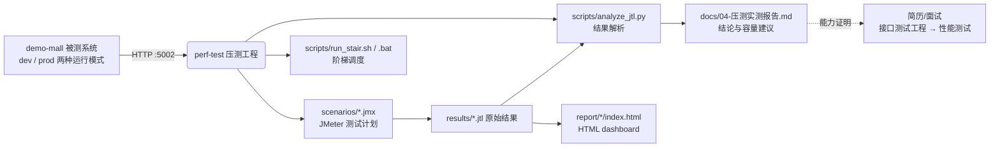

# perf-test / 项目总览（文档00）

> 一句话：这个模块把"压测"从一条命令变成一个工程——脚本可参数化、执行可调度、结果可复现、结论可交付。

## 1. 在整个工程中的位置



上下游关系：
- **上游**是被测系统 demo-mall（`python run.py --port 5002 [--mode prod]`）。perf-test 对它只有 HTTP 读压力（goods_list）和真实业务写压力（order_flow），不修改它的任何代码。
- **下游**是三份产出：jtl 原始数据（可进 CI 归档）、HTML dashboard（人看）、实测报告 markdown（晋升/面试/容量规划用）。
- 与 api-test-framework 的分工：**接口测试证明"功能对不对"，压测证明"扛不扛得住"**。两者共用同一套种子数据和错误码约定，结论可以互相引用（比如接口框架发现 500 的地方，压测里会表现为错误率尖刺）。

## 2. 涉及文件

| 文件 | 职责 |
|---|---|
| `scenarios/goods_list.jmx` | 核心查询接口压测脚本：线程数/RampUp/时长/目标地址全部 `${__P()}` 参数化，带 JSON 断言 |
| `scenarios/order_flow.jmx` | 混合业务场景：注册→登录→加购→查购物车→下单→支付，token 与 order_id 两级关联，每步断言 |
| `data/users.csv` | CSV 数据集组件的数据文件（两行种子账号），配合 goods_list.jmx 里"演示用"的 CSV 配置 |
| `scripts/run_stair.sh` | 阶梯压测调度：50/100/150 三档顺序执行，每档独立 jtl + HTML 报告，档间 reset + 休息 |
| `scripts/run_stair.bat` | 同功能的 Windows 批处理版（无 Git Bash 环境时用） |
| `scripts/analyze_jtl.py` | 解析 jtl：总请求/错误率/TPS/平均/P50/P90/P95/P99/max，输出 markdown 表格，纯标准库 |
| `results/*.jtl`、`report/*` | 运行产物（.gitignore，不入库） |
| `docs/01~05` | 场景设计 → 脚本详解 → 执行与报告 → 实测报告 → 坑与面试 |

## 3. 如何实现（工程分层）

一个能长期维护的压测工程分四层，每层只做一件事：

```
┌─ 调度层 scripts/run_stair.* ── 多档位编排、reset、产物命名、汇总
├─ 场景层 scenarios/*.jmx ────── 业务动作怎么模拟（线程、请求、断言、关联）
├─ 数据层 data/users.csv ─────── 账号等参数数据与脚本分离
└─ 解析层 scripts/analyze_jtl.py ─ 原始结果 → 指标 → 报告
```

1. **场景层**是核心。查询场景（goods_list）回答"系统每秒能扛多少次读"；业务场景（order_flow）回答"真实用户走完一段购买流程，系统还稳不稳"。两个场景互补：前者好对比（dev vs prod），后者容易暴露写路径的问题（锁、唯一约束、库存）。
2. **调度层**保证"每档之间世界状态一致"：reset 数据 → 预热 → 压测 → 休息，避免上一档的余压污染下一档的数字。
3. **数据层**把"账号"从脚本里抽出去。本工程场景少，users.csv 只有两行，但组件配置是完整的——账号一旦需要几十上百个，只改 csv 不改脚本。
4. **解析层**让结果可比较：同一口径（TPS=请求数/实际时长，分位数用线性插值）算出每一档的表，直接粘进报告。

## 4. 为什么这样设计

| 决策 | 备选方案 | 选择理由 |
|---|---|---|
| JMeter（.jmx 脚本） | Locust（Python 写场景）/ wrk（纯 HTTP） | JMeter 是国内测开 JD 出现率最高的工具；GUI 编辑 + 非 GUI 运行 + HTML dashboard 全链路都有标准产物，教学价值与求职价值都最高。wrk 压不了"带 token 关联的业务链"，Locust 需要写 Python 且报告生态弱 |
| 场景拆成查询 + 业务两个 jmx | 一个大脚本全包 | 查询场景要"干净"（无登录、无写库）才能单独归因到服务器读路径；业务场景必须带状态。混在一起时一旦出错无法归因 |
| 参数全部走 `${__P()}` | 硬编码在 jmx 里 | 一份脚本打 dev/prod、打不同档位、换端口都不用改文件；`-J` 属性是 JMeter 原生机制，无额外依赖 |
| 结果解析自写 analyze_jtl.py | 只看 HTML dashboard | dashboard 是给人看单次运行的；跨档位对比、进报告、进 git 需要纯文本表格。且 jtl 是公开 CSV 格式，自写解析顺便吃透指标口径 |
| 产物目录 results/ report/ 不入库 | 把 jtl 提交进 git | jtl 动辄几万行，报告是静态站点；入库会让仓库膨胀。真正要保留的"结论数字"进 docs/04 |

## 5. 怎么运行/验证

```bash
# 验证 1：JMeter 可用（真实输出）
$ export PATH="/c/Users/37535/tools/apache-jmeter-5.6.3/bin:$PATH"
$ jmeter --version
... Copyright (c) 1999-2024 The Apache Software Foundation   5.6.3

# 验证 2：冒烟（真实输出，2026-10-25，dev 模式 5002）
$ jmeter -n -t scenarios/goods_list.jmx -Jthreads=10 -Jrampup=5 -Jduration=20 -Jport=5002 \
         -l results/smoke.jtl -e -o report/smoke
summary =  12004 in 00:00:20 =  599.2/s Avg:    14 Min:     2 Max:    60 Err:     0 (0.00%)

# 验证 3：解析脚本（真实输出）
$ python scripts/analyze_jtl.py results/smoke.jtl
| 结果文件 | 总请求 | 错误数 | 错误率 | 时长(s) | TPS | 平均(ms) | P50 | P90 | P95 | P99 | max |
|---|---|---|---|---|---|---|---|---|---|---|---|
| results/smoke.jtl | 12004 | 0 | 0.00% | 19.9 | 601.8 | 14.6 | 15 | 20 | 23 | 29 | 60 |
```

## 6. 常见坑

1. **JMeter 不加永久 PATH**：`jmeter` 命令依赖 JAVA_HOME 与其 bin 目录；写进系统 PATH 后任何目录都能跑，容易误触发，也会和别的工具（如接口自动化框架里的 jmeter-maven 插件）抢版本。只在会话里 `export PATH`。
2. **`-o` 报告目录必须不存在或为空**：JMeter 生成 HTML dashboard 前会检查目标目录，非空直接报错退出。调度脚本里都先 `rm -rf` 再跑。
3. **多实例共享 demo_mall.db**：本机 5000/5001/5002 三个 mall 实例如果都从同一目录启动，共享同一个 SQLite 文件；任何一方 reset，另一方正在跑的压测会突然大面积 1001/401（登录态对应的用户没了）。结论：压测期间协调好"谁拥有数据库"。
4. **GUI 里点运行 ≠ 压测**：GUI 模式本身吃内存、监听器会拖慢采样，数据失真。压测一律 `-n` 非 GUI。

## 7. 面试怎么讲

**30 秒版本**：
"我为 demo-mall 搭了一套 JMeter 压测工程：核心查询接口全参数化（并发/时长/目标一键切换），混合业务场景做了 token 和 order_id 两级关联，脚本层带 JSON 断言保证错误率真实。用阶梯压测（50/100/150 并发）对比了 Flask dev server 和 waitress，实测 waitress 在 50 并发下 TPS 1100、P95 62ms、0 错误，而 dev server 在 50 并发以上因为每请求短连接把压测机端口耗尽直接不可用。压测还顺带发现了被测系统订单号在高并发下的唯一键碰撞缺陷。"

**高频追问**：
1. *"你怎么保证压测数字是可信的？"* —— 三步：冒烟先行（10 并发 0 错误再上量）；每档前 reset + 预热，保证起点一致；错误码逐个归因（错误率不是黑盒数字，我会把 jtl 里的 responseCode 分布拉出来，比如 dev 高并发全是客户端 BindException，这不是服务端数据）。
2. *"TPS 怎么算的？为什么不用 JMeter 界面里的 throughput？"* —— TPS = 总请求数 / 实际时长（第一笔发出到最后一笔完成的墙钟时间），和 dashboard 的 throughput 口径一致；自己再算一遍是为了跨档位、跨机器、跨时间可比，analyze_jtl.py 里口径写在注释里。
3. *"dev 和 prod 差多少，为什么？"* —— 低并发（10）两者都行（dev 甚至延迟更低）；50 并发起 dev 每请求 `Connection: close` 导致连接反复重建，压测机 16k 临时端口被 TIME_WAIT 吃光，一半以上请求连不上；waitress 支持 keep-alive 且 8 工作线程，50 并发 TPS 1100、P95 62ms，150 并发仍 0 错误（代价是超出 connection_limit=100 的连接排队，出现 20s 级长尾）。

## 8. 复现任务清单

| # | 任务 | 验收标准 |
|---|---|---|
| 1 | 安装 JDK17 + 解压 JMeter 5.6.3 到 tools 目录 | `jmeter --version` 打印 5.6.3 |
| 2 | 启动 demo-mall（dev，5002） | `curl http://127.0.0.1:5002/api/health` 返回 code=0 |
| 3 | 跑冒烟：`-Jthreads=10 -Jduration=20` | jtl 与 report/smoke/index.html 生成，Err 0 (0.00%) |
| 4 | `bash scripts/run_stair.sh`（dev 三档） | results/ 出现 3 个 jtl，report/ 出现 3 个 HTML 目录 |
| 5 | 改 `--mode prod` 重启，`MODE=prod bash scripts/run_stair.sh` | 同上，且 prod 三档错误率 0 |
| 6 | `python scripts/analyze_jtl.py results/goods_*.jtl` | 打出 markdown 表格，TPS/P95 与 docs/04 同量级 |
| 7 | reset 后跑 order_flow（`-Jthreads=10 -Jloops=6 -Jthink_time=800`） | Err 0 (0.00%)，DB 里 60 笔订单全部 paid |
| 8 | 浏览器打开任一 index.html | Statistics 页能找到本场景的 P95/TPS |
