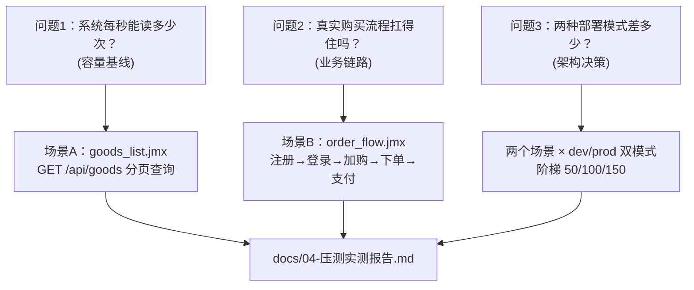

# 压测场景设计（perf-test · 文档01）

> 一句话：先想清楚"用什么样的负载回答什么问题"，再写脚本——场景设计决定压测结论有没有意义。

## 1. 在整个工程中的位置



本篇是"为什么"，`02-JMeter脚本详解.md` 是"怎么做"。

## 2. 涉及文件

| 文件 | 职责 |
|---|---|
| `scenarios/goods_list.jmx` | 场景A：核心查询接口负载/压力测试 |
| `scenarios/order_flow.jmx` | 场景B：混合业务链路回归式压测 |
| `scripts/run_stair.sh` / `.bat` | 把场景A按 50/100/150 三档调度执行 |
| `data/users.csv` | 场景B扩展时的账号数据源（当前演示配置） |

## 3. 如何实现（逐个设计决策）

### 3.1 基准 / 负载 / 压力测试的区别与分工

| 类型 | 并发策略 | 回答的问题 | 判定标准 | 本工程对应 |
|---|---|---|---|---|
| **基准测试** Benchmark | 1~10 并发，短时间 | 系统的"底牌"：单请求多快？零竞争下吞吐多少？ | 延迟稳定、错误率 0 | 冒烟档：10 并发 20s（TPS 601.8，P95 23ms） |
| **负载测试** Load | 逐步加到"预期峰值" | 预期流量下系统是否达标？ | SLA 内（如 P95 < 200ms、错误率 < 0.1%） | 阶梯 50/100 并发 |
| **压力测试** Stress | 持续加压超过峰值 | 系统在哪里崩？崩的方式是变慢还是出错？ | 找到拐点/极限，观察失效模式 | 阶梯 150 并发（超出 waitress connection_limit） |

一次合格的压测 = **基准打底 → 负载验证 → 压力找边界**。跳过基准直接打高并发，出了问题你连"正常值长什么样"都不知道。

### 3.2 为什么核心查询接口选 GET /api/goods

候选接口有：`GET /api/health`（太简单，无业务逻辑）、`GET /api/goods?page=1&page_size=5`、`POST /api/auth/login`（有密码哈希 CPU 开销）、`POST /api/orders`（有写库+锁）。

选 `/api/goods` 的理由：
1. **代表性**：真实商城流量大头是浏览（读写比通常 9:1 以上），商品列表是首页/列表页的底层数据源；
2. **有真实工作**：两条 SQL（COUNT + 分页 SELECT，LIKE 过滤）+ JSON 序列化，能反映服务端 CPU/DB 开销，不像 /api/health 测出来只是网络栈性能；
3. **无状态、免鉴权**：不需要 token 关联，错误率语义干净（断言失败=服务真的错了）；
4. **可重复**：纯读，跑一万次数据不变，档位之间天然可比（这是选它当"标尺接口"的关键）。

### 3.3 阶梯档位 50/100/150 的依据

档位不是拍脑袋：
- **50**：本地 Flask/waitress 应用的"日常目标区间"。demo-mall 是教学级单体，50 并发约等于一个中小型内部系统的峰值；
- **100**：翻倍试探。如果 TPS 能随并发翻倍，说明还有余量；如果 TPS 持平甚至下降，说明到达吞吐拐点（排队理论：并发数 × 平均响应时间 ≈ 吞吐，并发翻倍而吞吐不涨 = 服务端已成瓶颈）；
- **150**：压力区，故意超过 waitress 的默认 `connection_limit=100`，观察系统"过载时怎么死"（实测结论：不崩溃、不报错，超出上限的连接排队等待，长尾延迟 20s+——这是很典型的背压行为）。

三档递增还服务于 Little's Law 验证：`并发数 = TPS × 平均响应时间`，每一档的实测三个数都应近似满足该式（详见 docs/04 表格，读者可自行验算）。

### 3.4 混合业务场景的动作序列设计

真实用户不是永动机循环刷新一个 GET，而是"登录 → 逛 → 加购 → 下单 → 支付"。order_flow 的链路：

```
[Once Only] 注册 perf_{线程号}      ← 每个虚拟用户独立账号（防购物车竞态，见 02 文档）
① POST /api/auth/login             ← 提取 data.token（关联1）
② POST /api/cart/items             ← 加购 goods_id=7（Bearer token）
③ GET  /api/cart                   ← 验证 token 关联 + 加购生效
④ POST /api/orders  {"from_cart":true} ← 提取 data.order_id（关联2）
⑤ POST /api/orders/{order_id}/pay  ← 变量替换完成下单→支付闭环
```

每步都有 JSON 断言（`$.code == 0`），任何一步业务失败都会计入错误率——**业务场景的错误率必须按"业务成败"算，而不是 HTTP 200**。

### 3.5 指标口径定义（全工程统一）

| 指标 | 定义 | 计算口径（analyze_jtl.py 实现） |
|---|---|---|
| **TPS** | 每秒完成的事务/请求数 | 总请求数 ÷ 实际时长；实际时长 = (max(timeStamp+elapsed) − min(timeStamp)) / 1000，即第一笔发出到最后一笔完成的墙钟时间 |
| **平均响应时间** | 所有采样 elapsed 的算术平均 | sum(elapsed)/N，单位 ms |
| **P50 / P90 / P95 / P99** | 分位数：X% 的请求快于该值 | elapsed 升序后线性插值（同 Excel PERCENTILE.INC），JMeter dashboard 的聚合分位与此口径接近 |
| **Max** | 最慢一笔 | max(elapsed)；离群值必须结合长尾样本数解读（1 个 20s 的 max 在 3 万样本里可能只是连接排队） |
| **错误率** | 失败采样占比 | JMeter 的 success 字段 = HTTP 层 + 断言结果的总和，断言失败也算错误——这是"错误率真实"的关键 |
| **有效 TPS** | 成功请求每秒 | (总请求 − 错误) ÷ 实际时长；错误率高时它才是真实产能 |

为什么看 P95 不看平均：平均会被大量快请求拉低，掩盖慢请求；P95 直接回答"最不爽的那 5% 用户等多久"。为什么 P99 和 Max 都要看：P99 之外还有 1%，Max 暴露的是最坏情况（连接排队、GC 停顿）。

## 4. 为什么这样设计

| 决策 | 备选方案 | 理由 |
|---|---|---|
| 阶梯（3 档固定） | 直接一档打满 500 并发 | 阶梯能看到"拐点在哪"，一档打满只能知道"500 时死了"，而容量规划需要的是曲线 |
| 查询场景免登录 | 登录后查询 | 免登录让错误归因纯粹：所有失败都是服务端/网络问题，不会混入 token 过期等脚本因素 |
| 业务场景每线程独立账号 | 全部共用 lemon 账号 | 共用账号时 A 线程下单清空购物车会连带买走 B 线程刚加购的商品，产生 3001 错误——脚本竞态会被误判成系统缺陷 |
| 思考时间 200~800ms 可调 | 零思考时间 | 零思考 = 每个虚拟用户是裸循环机器人，和真实用户行为差太远；且下单接口的 order_no 生成算法依赖"同一秒内的碰撞概率"，思考时间是控制碰撞密度的手段（实测发现的被测系统缺陷，见 docs/04） |
| 30 秒/档 | 5 秒/档 × 更多档位 | 太短（<10s）JVM/JIT 预热和 TCP 慢启动会扭曲数据；30s 足够让队列到达稳态，6 档总时长也可接受 |

## 5. 怎么运行/验证

```bash
# 场景A 冒烟（基准）——真实输出见 docs/00
jmeter -n -t scenarios/goods_list.jmx -Jthreads=10 -Jrampup=5 -Jduration=20 -Jport=5002 \
       -l results/smoke.jtl -e -o report/smoke

# 场景A 阶梯（负载+压力）
bash scripts/run_stair.sh

# 场景B 业务链路（先 reset！）
curl -X POST http://127.0.0.1:5002/api/test/reset -H "X-Test-Key: mall-test-key"
jmeter -n -t scenarios/order_flow.jmx -Jthreads=10 -Jrampup=5 -Jloops=6 -Jthink_time=800 \
       -Jport=5002 -l results/order_flow.jtl -e -o report/order_flow

# 验收：310 个请求、0 错误；DB 侧 60 笔订单全部 paid，goods 7 库存 200→140
```

## 6. 常见坑

1. **把冒烟数字当容量结论**：10 并发 TPS 600 ≠ 系统容量 600。容量要按"满足 P95 目标的最大并发"来定义，冒烟只是底线体检。
2. **档位间不 reset / 不休息**：上一档的排队请求、TIME_WAIT 连接会污染下一档前几秒的数据；脚本里 reset + sleep 3 不是仪式感。
3. **只用平均响应时间**：平均 87ms（prod@100 并发）听起来不错，但 P95 144ms、max 20s——不看分位数会漏掉"部分用户极度难受"的事实。
4. **业务场景忘记 reset**：order_flow 跑两次之间不 reset，第二次撞"用户名已存在"（脚本已用宽断言容忍）+ 库存减半（200→140→80，圈数不变就会撞 2002）。跑前 reset 是硬纪律。

## 7. 面试怎么讲

**30 秒版本**：
"我设计压测场景时先分层：基准档摸底牌，负载档验证 SLA，压力档找拐点。核心查询接口选 /api/goods，因为它是读多写少商城里流量最大、且可重复免鉴权的标尺接口；再配一个注册到支付的混合业务链路，用 token 和 order_id 关联模拟真实用户。档位 50/100/150 是按 Little's Law 预估的：50 是目标区间，100 看吞吐是否翻倍，150 故意超过 waitress connection_limit 看失效模式。指标口径统一 TPS=请求数/墙钟时长，主看 P95 和错误率，错误率包含断言失败，保证业务错不算成功。"

**高频追问**：
1. *"为什么选 /api/goods 做标尺而不是首页聚合接口？"* —— demo-mall 没有首页聚合，且标尺接口要"单一变量"：只有商品列表的 COUNT+分页 SQL，出错好归因。真实项目里标尺接口应该是流量画像里 TOP1 的只读接口。
2. *"150 并发怎么定的？"* —— 压力档按"超配 50%"的经验值定在预期拐点之外；这里还叠加了一个架构事实：waitress 默认 connection_limit=100，150 能直接验证过载行为，实测确实复现了 20s 级排队。
3. *"错误率 0.1% 的 SLA 怎么定？"* —— 按业务容忍度反推：商城浏览页每秒几千次请求，0.1% 意味着每 10 分钟一次用户可见失败，属于可接受；支付链路要按 0.01% 甚至 0 定，因为单笔失败就是资损客诉。本项目实测 prod 三档 0 错误。

## 8. 复现任务清单

| # | 任务 | 验收标准 |
|---|---|---|
| 1 | 写下本场景"要回答的 3 个问题"（容量/链路/模式对比） | 能用一句话各回答一个 |
| 2 | 跑冒烟档并记录 TPS/P95 | 数字落在 docs/04 同档 ±20% |
| 3 | 跑 50 档，用 Little's Law 验算：TPS×avg ≈ 并发 | 误差 < 15% |
| 4 | 跑 150 档（prod），在 waitress 日志里找 connection limit 告警 | `grep "connection limit" 日志` 有告警行 |
| 5 | 跑 order_flow 前后各查一次 DB（订单数/库存/用户数） | 订单数=线程数×圈数，库存差=订单总件数 |
| 6 | 把每档数字填进 docs/04 的表格 | 表格完整、标注实测时间与端口 |
