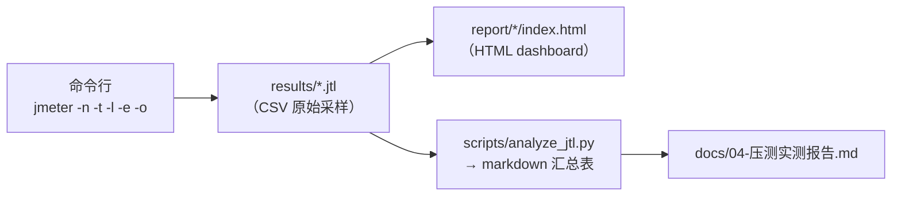

# 执行与报告解读（perf-test · 文档03）

> 一句话：非 GUI 四件套怎么用、HTML dashboard 每个区块看什么、聚合报告每列什么含义——全部用本机真实输出讲解。

## 1. 在整个工程中的位置



执行层把"脚本"变成"数据"，报告层把"数据"变成"结论"。

## 2. 涉及文件

| 文件 | 职责 |
|---|---|
| `results/*.jtl` | CSV 格式原始采样，一行一笔请求，是所有报告的源头 |
| `report/<名称>/index.html` | JMeter HTML dashboard（纯静态站点，可直接发给他人） |
| `scripts/analyze_jtl.py` | 跨文件汇总 jtl，输出 markdown 表格 |
| `scripts/run_stair.sh` / `.bat` | 多档位执行的封装（含 -o 目录清理、reset、命名） |

## 3. 如何实现

### 3.1 非 GUI 四件套：`-n -t -l -e -o`

```bash
jmeter -n \
       -t scenarios/goods_list.jmx \      # -t：测试计划文件
       -Jthreads=10 -Jrampup=5 -Jduration=20 -Jport=5002 \   # -J：属性注入（覆盖 ${__P()} 默认值）
       -l results/smoke.jtl \             # -l：原始结果落盘（jtl，无则新建，有则追加！）
       -e -o report/smoke                 # -e：结束后生成 HTML 报告；-o：报告输出目录（必须为空/不存在）
```

真实输出（2026-10-25，dev 模式 5002，10 并发 20s）：

```
Creating summariser <summary>
Created the tree successfully using scenarios/goods_list.jmx
Starting standalone test @ 2026 Oct 25 05:17:13 CST (1792876633356)
Waiting for possible Shutdown/StopTestNow/HeapDump/ThreadDump message on port 4445
summary +   9670 in 00:00:17 =  583.5/s Avg:    14 Min:     2 Max:    60 Err:     0 (0.00%) Active: 10 Started: 10 Finished: 0
summary +   2334 in 00:00:03 =  674.2/s Avg:    14 Min:     6 Max:    41 Err:     0 (0.00%)
summary =  12004 in 00:00:20 =  599.2/s Avg:    14 Min:     2 Max:    60 Err:     0 (0.00%)
Tidying up ...    @ 2026 Oct 25 05:17:33 CST (1792876653465)
... end of run
```

逐行解读：
- `Waiting for ... on port 4445`：JMeter 起了远程停止监听，另开终端 `jmeter -s` 或发送 shutdown 消息可优雅中止长压测；
- `summary +`：**增量**行（每 30 秒或 100 个采样刷新一次），看"当前时段"的状态；
- `summary =`：**累计**行，是整个压测的最终口径：12004 笔、599.2/s、Err 0；
- `Active: 10 Started: 10 Finished: 0`：活动线程数，若压测结束后 Active 不归零说明有线程卡死（常见于没设超时的挂起请求）。

为什么必须非 GUI：GUI 的 Swing 界面、实时渲染、监听器内存都会与被测系统抢 CPU，官方文档明确要求正式压测用 `-n`。GUI 只用来编辑脚本和调试单请求。

### 3.2 jtl 文件结构（CSV）

```
timeStamp,elapsed,label,responseCode,responseMessage,threadName,dataType,success,failureMessage,bytes,sentBytes,grpThreads,allThreads,URL,Latency,IdleTime,Connect
1792876633516,21,GET /api/goods 商品列表,200,OK,线程组-商品列表查询 1-1,text,true,,1075,145,1,1,http://127.0.0.1:5002/api/goods?page=1&page_size=5,21,0,0
```

| 列 | 含义 | 用途 |
|---|---|---|
| timeStamp | 采样开始时刻（epoch 毫秒） | 算 TPS 的分母（墙钟时长）、画时间轴曲线 |
| elapsed | 响应时间（ms） | 平均/分位数指标的唯一来源 |
| label | 取样器名 | 一个场景压多个接口时按标签分组统计 |
| responseCode / responseMessage | HTTP（或 Non HTTP response）状态 | 归因：200+code≠0 是业务错；BindException 是压测机错 |
| threadName | `线程组 1-3`（组号-线程号） | 定位某根线程的行为（如某线程卡死） |
| success | HTTP 层 + 断言层综合结果 | 错误率的分子 |
| failureMessage | 断言失败原因 | 失败归因第一现场 |
| bytes | 响应字节数（含响应头） | 网络吞吐估算；注意**含头**，67 字节 body 会显示 193 |
| Latency / Connect | 首字节耗时 / TCP 建连耗时 | Connect 高=建连排队（压测机端口耗尽/服务端 accept 满），Latency 高=服务端处理慢 |

`Connect` 和 `Latency` 的区分是排查利器：Connect 时间占比高 → 问题在网络/连接管理（压测机或内核）；Latency 高而 Connect≈0 → 问题在服务端处理。

### 3.3 HTML dashboard 怎么看

`-e -o report/smoke` 生成的静态站点，重点看四处：

1. **Statistics（首页表格）**：全场景总表——每行一个 label，列包括 Samples/Error%/Mean/Median/90th/95th/99th pct/Min/Max/Throughput/Received/SENT。**Throughput = 总量/墙钟时长**，和 analyze_jtl.py 的 TPS 同口径；
2. **APDEX**：应用性能满意度指数。阈值在 `reportgenerator.properties` 可配（默认 500ms/1500ms），本工程查询接口实测 APDEX=1.0（全部样本落在满意阈值内）；
3. **Response Time Percentiles / Over Time 曲线**：看拐点形状——阶梯压测时把三档的曲线放一起，"并发涨、延迟涨、TPS 不涨"的那一刻就是拐点；
4. **Errors 页**：断言失败/连接失败按类型聚合计数，快速回答"错的是什么"。

辅助技巧：报告是纯静态文件，`report/<名称>/` 直接压缩发人或丢 nginx 都行；三档报告用不同目录名（脚本按 `goods_dev_t50` 命名）避免 `-o` 目录冲突。

### 3.4 聚合报告每一列的含义（GUI 版对照）

| 列 | 含义 | 与 dashboard/自算口径的关系 |
|---|---|---|
| Samples | 该标签采样数 | 同 Statistics 页 |
| Average | 平均 elapsed | = analyze_jtl.py 的 平均(ms) |
| Median | P50 | 分位数线性插值，大样本下与自算差异 <1ms |
| 90%/95%/99% Line | P90/P95/P99 | 同上 |
| Min/Max | 最快/最慢 | Max 对离群极敏感，结合 Errors 页解读 |
| Error % | 失败样本占比 | 含断言失败——这就是"业务错也算错"的落地 |
| Throughput | 总量/总时长 | 与自算 TPS 同口径；多 label 时是全计划合并口径 |
| Received/sent KB/sec | 网络吞吐 | 压测机网卡容量评估用 |

### 3.5 analyze_jtl.py 用法与实现要点

```bash
python scripts/analyze_jtl.py results/smoke.jtl
python scripts/analyze_jtl.py results/goods_dev_t*.jtl   # Windows cmd 下脚本内部做了 glob 兜底
```

真实输出（2026-10-25）：

```
| 结果文件 | 总请求 | 错误数 | 错误率 | 时长(s) | TPS | 平均(ms) | P50 | P90 | P95 | P99 | max |
|---|---|---|---|---|---|---|---|---|---|---|---|
| results/goods_dev_t50.jtl  | 11649 |  7482 | 64.23% | 30.0 | 388.6 | 107.4 | 128 | 166 |  179 |  213 |  665 |
| results/goods_dev_t100.jtl | 12644 | 12623 | 99.83% | 30.0 | 421.9 | 198.1 | 243 | 277 |  286 |  346 |  956 |
| results/goods_dev_t150.jtl | 18028 | 16117 | 89.40% | 30.2 | 597.8 | 207.3 |  41 | 481 | 1108 | 3201 | 4021 |
| results/goods_prod_t50.jtl | 32975 |     0 |  0.00% | 30.0 | 1100.4 | 38.0 | 41 | 58 |   62 |   73 |  122 |
| results/goods_prod_t100.jtl| 28751 |     0 |  0.00% | 30.0 |  958.0 | 87.3 | 94 | 133 |  144 |  160 | 20281 |
| results/goods_prod_t150.jtl| 28000 |     0 |  0.00% | 30.1 |  931.6 | 134.4 | 103 | 133 | 142 | 160 | 23546 |
```

实现要点（对照源码看）：
- `csv.DictReader` 读 jtl，按表头取列——不依赖列序；
- **TPS 的分母用"第一笔发出→最后一笔完成"**：`max(timeStamp+elapsed) - min(timeStamp)`，与 dashboard 同口径；
- 分位数：升序后线性插值（`lo + (hi-lo)*(k-lo_int)`），同 Excel PERCENTILE.INC；
- 纯标准库（csv/glob/sys），零依赖，可直接进 CI。

## 4. 为什么这样设计

| 决策 | 备选方案 | 理由 |
|---|---|---|
| jtl 作为唯一原始产物 | 只留 HTML 报告 | jtl 是可再加工的源头数据（重算分位、按线程分析、二次画图），HTML 只是一次渲染 |
| 自写 analyze_jtl.py | InfluxDB+Grafana / dashboard 截图 | 教学目标是吃透口径；且表格能直接进 markdown 报告与 git。真实大项目再加 Grafana 监控不冲突 |
| report 目录按"场景_模式_档位"命名 | 统一一个 report/ | `-o` 要求目录为空，且三档报告并存便于横向对照 |
| 档间 sleep 3s | 连续背靠背 | TIME_WAIT 与服务端排队需要排空时间，否则下一档前几秒数据偏高 |

## 5. 怎么运行/验证

```bash
# 1. 执行（真实输出见 3.1）
export PATH="/c/Users/37535/tools/apache-jmeter-5.6.3/bin:$PATH"
cd /d/软件测试/perf-test
jmeter -n -t scenarios/goods_list.jmx -Jthreads=10 -Jrampup=5 -Jduration=20 -Jport=5002 \
       -l results/smoke.jtl -e -o report/smoke

# 2. 校验产物
ls results/smoke.jtl report/smoke/index.html       # 两者都存在

# 3. 解析
python scripts/analyze_jtl.py results/smoke.jtl    # 表格见 3.5

# 4. dashboard 校验：打开 report/smoke/index.html，Statistics 页 Error% 应为 0.00%
```

优雅中止长压测：另开终端 `shutdown.sh`（JMeter bin 下）或 `jmeter -n ... ` 时记录的 4445 端口发送停测指令。

## 6. 常见坑

1. **`-l` 指向已存在的 jtl 会追加而不是覆盖**：新旧数据混在一起，TPS 翻倍、分位数失真。脚本里先 `rm -f`，或每次用带时间戳的文件名。
2. **`-o` 目录非空直接报错**：`Cannot write ... is not empty`。run_stair.sh 每档先 `rm -rf report/<档位>`。
3. **bytes 列包含响应头**：67 字节的 JSON body 显示 193。算纯业务流量时要用 dashboard 的 Received/sent KB/sec 或自己扣头。
4. **max/P99 的离群值要查样本数**：prod@150 的 max 23546ms 看似灾难，实际只有 52/28000 笔超过 1s（waitress connection_limit 排队），P95 仍只有 142ms——离群值必须结合"超过阈值的样本数"解读，否则结论完全相反。
5. **summary 行是异步刷新的**：30 秒刷新一次的增量行，最后几秒的数据会并入 `... end of run` 前的最后一行；最终口径以 `summary =` 累计行为准。

## 7. 面试怎么讲

**30 秒版本**：
"执行层我用标准四件套：-n 非 GUI、-t 指定脚本、-l 落 jtl、-e -o 生成 dashboard，并发和时长全走 -J 属性。报告层我看三层：jtl 原始数据用来归因（重点区分 Connect 和 Latency——建连慢是压测机或内核问题，处理慢才是服务端问题）；dashboard 的 Statistics 和 Errors 页看总体和错误类型；再往上我写了个纯标准库的 analyze_jtl.py，把多档 jtl 按'请求数/墙钟时长'统一口径算 TPS 和分位数，输出 markdown 表格直接进报告。比如实测里 prod 150 并发的 max 有 23 秒，但结合 jtl 一查只有 52 笔请求超 1 秒，是 waitress connection_limit 排队，P95 才 142ms——这就是必须会读原始数据的原因。"

**高频追问**：
1. *"jtl 和 dashboard 报告什么关系？"* —— jtl 是源头（一行一笔请求），dashboard 是对 jtl 的一次渲染；只要 jtl 在，报告随时可以重新生成（`jmeter -g results/x.jtl -o report/x`），甚至换工具重画。
2. *"TPS 和 QPS 什么区别？"* —— 本工程一个采样=一个 HTTP 请求，两者相等；若一个"事务"由多个请求组成（如登录+下单+支付算一笔），TPS 应按事务计数，QPS 按请求数——口径要先定义再对比。
3. *"怎么判断瓶颈在压测机还是被测系统？"* —— 四查：Connect 时间占比（压测机端口/CPU）、压测机 CPU/内存（>80% 时数据不可信）、错误码分布（BindException=压测机，Connection refused/reset=服务端 accept）、以及换一台压测机复测验证。本次 dev 模式 64%~99% 错误率就是靠错误码分布定位到压测机端口耗尽的。

## 8. 复现任务清单

| # | 任务 | 验收标准 |
|---|---|---|
| 1 | 跑冒烟并逐行解读 summary 输出 | 能说清 `summary +` 与 `summary =` 的区别 |
| 2 | 打开 jtl 前两行，指出 17 列各自的含义 | 对照 3.2 表格无遗漏 |
| 3 | 浏览器打开 report/smoke/index.html | Statistics 页 Error% = 0.00%，APDEX = 1.00 |
| 4 | 故意跑一次错误压测（-Jport=5999）后看 Errors 页 | 错误分类为 ConnectException |
| 5 | 用 analyze_jtl.py 汇总 dev 三档 | 表格与本文 3.5 数字同量级 |
| 6 | 用 `jmeter -g results/smoke.jtl -o report/re-render` 重新渲染 | 证明 jtl 是源头数据 |
