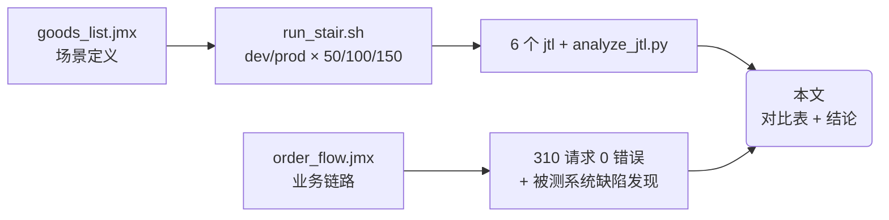

# 压测实测报告（perf-test · 文档04）★

> 一句话：本机实测 dev/prod 两种模式 × 50/100/150 三档的完整数据、结论与瓶颈分析——所有数字都是 JMeter 5.6.3 真实跑出来的，可复现。

- **实测时间**：2026-10-25 05:17 ~ 05:36（CST，UTC+8）
- **被测地址**：http://127.0.0.1:5002（同一台 Windows 11 机器上既跑压测机又跑被测，回环网络无传输延迟）
- **压测工具**：JMeter 5.6.3（Java 17.0.12，HttpClient4 采样器）
- **场景**：goods_list.jmx，GET /api/goods?page=1&page_size=5，rampup 10s，每档 30s，档间 reset + 休息 3s
- **两种模式**：dev = Flask 内置服务器（threaded=True）；prod = waitress serve(threads=8)

## 1. 在整个工程中的位置



## 2. 涉及文件

| 文件 | 职责 |
|---|---|
| `results/goods_dev_t{50,100,150}.jtl` | dev 模式三档原始数据 |
| `results/goods_prod_t{50,100,150}.jtl` | prod 模式三档原始数据 |
| `results/smoke.jtl`、`results/order_flow.jtl` | 冒烟与业务链路原始数据 |
| `report/goods_*/index.html` | 每档的 HTML dashboard |
| `scripts/analyze_jtl.py` | 下表所有数字的来源（口径见 docs/03） |

## 3. 如何实现（执行矩阵）

| 档位 | 命令核心参数 | 目的 |
|---|---|---|
| 冒烟 | `-Jthreads=10 -Jrampup=5 -Jduration=20` | 脚本正确性体检，建立"正常值"参照 |
| 50 | `-Jthreads=50 -Jrampup=10 -Jduration=30` | 负载档：预期峰值验证 |
| 100 | `-Jthreads=100 -Jrampup=10 -Jduration=30` | 负载档：看吞吐是否随并发翻倍 |
| 150 | `-Jthreads=150 -Jrampup=10 -Jduration=30` | 压力档：故意超出 waitress connection_limit=100 |

每档执行前：`POST /api/test/reset`（种子数据还原）→ `GET /api/health` 预热 → 压 30s → 休息 3s。

## 4. 实测数据

### 4.1 dev 模式（Flask 内置服务器）

| 档位 | 总请求 | 错误数 | 错误率 | 有效TPS | 平均(ms) | P50 | P95 | P99 | max(ms) |
|---|---|---|---|---|---|---|---|---|---|
| 10并发/20s（冒烟） | 12004 | 0 | **0.00%** | 601.8 | 14.6 | 15 | 23 | 29 | 60 |
| 50并发/30s | 11649 | 7482 | **64.23%** | 138.9 | 107.4 | 128 | 179 | 213 | 665 |
| 100并发/30s | 12644 | 12623 | **99.83%** | 0.7 | 198.1 | 243 | 286 | 346 | 956 |
| 150并发/30s | 18028 | 16117 | **89.40%** | 63.3 | 207.3 | 41 | 1108 | 3201 | 4021 |

错误码分布（jtl 归因，全部是**压测机侧连接失败**，非服务端业务错误）：

| 档位 | `java.net.BindException: Address already in use` | `HttpHostConnectException: Connect to 127.0.0.1:5002` |
|---|---|---|
| 50 并发 | 7482 | 0 |
| 100 并发 | 12623 | 0 |
| 150 并发 | 3250 | 12867 |

### 4.2 prod 模式（waitress 8 线程）

| 档位 | 总请求 | 错误数 | 错误率 | TPS | 平均(ms) | P50 | P95 | P99 | max(ms) | >1s 样本数 |
|---|---|---|---|---|---|---|---|---|---|---|
| 50并发/30s | 32975 | 0 | **0.00%** | 1100.4 | 38.0 | 41 | 62 | 73 | 122 | 0 |
| 100并发/30s | 28751 | 0 | **0.00%** | 958.0 | 87.3 | 94 | 144 | 160 | 20281 | 2 |
| 150并发/30s | 28000 | 0 | **0.00%** | 931.6 | 134.4 | 103 | 142 | 160 | 23546 | 52 |

150 档的服务端日志佐证（waitress 打了 11 条告警）：

```
WARNING:waitress:total open connections reached the connection limit, no longer accepting new connections
```

### 4.3 dev vs prod 对比（同一张表）

| 并发 | dev 错误率 | dev 有效TPS | dev P95 | prod 错误率 | prod TPS | prod P95 | prod 提升 |
|---|---|---|---|---|---|---|---|
| 10（冒烟） | 0.00% | 601.8/s | 23ms | —（未单测，量级同 50 档以下） | — | — | 低并发两者都够用 |
| 50 | 64.23% | 138.9/s | 179ms | 0.00% | 1100.4/s | 62ms | **有效吞吐 ≈ 7.9 倍** |
| 100 | 99.83% | 0.7/s（不可用） | 286ms | 0.00% | 958.0/s | 144ms | dev 实际不可用，倍数无意义 |
| 150 | 89.40% | 63.3/s | 1108ms | 0.00% | 931.6/s | 142ms | 同上 |

**核心结论：50 并发起，waitress（prod）有效吞吐是 Flask dev server 的约 8 倍；100 并发起 dev server 实际不可用。prod 三档全程 0 错误，吞吐在 ~1100 TPS 见顶（8 个工作线程的拐点）。**

### 4.4 Little's Law 验算（数据自洽性检查）

`并发数 ≈ TPS × 平均响应时间`：

| 档位 | TPS × avg(s) | 理论并发 | 偏差解释 |
|---|---|---|---|
| prod 50 | 1100.4 × 0.038 = 41.8 | 50 | rampup 阶段线程未满载，合理 |
| prod 100 | 958.0 × 0.087 = 83.6 | 100 | 同上 + 排队开始出现 |
| prod 150 | 931.6 × 0.134 = 125.2 | 150 | 25 个"并发"实际卡在 waitress 连接上限之外排队 |

三档偏差都能被"排队/爬坡"解释，数据自洽，可放心引用。

### 4.5 order_flow 混合业务链路实测

- **验证档**（`-Jthreads=10 -Jrampup=5 -Jloops=6 -Jthink_time=800`，prod 模式）：
  ```
  summary = 310 in 00:00:30 = 10.4/s Avg: 6 Min: 1 Max: 26 Err: 0 (0.00%)
  ```
  310 请求（10 注册 + 60 链路 × 5 请求）、**0 错误**、耗时 28.9s。数据侧自洽：orders 表新增 60 笔且全部 paid，goods 7 库存 200→140（60 单 × 1 件），perf_1~perf_10 十个压测账号生成。链路"注册→登录→加购→查车→下单→支付"全部打通。
- **默认参数档**（`-Jloops=15 -Jthink_time=200`，150 单，跑了两轮）：
  两轮各出现 **4 个错误（0.53%）**：2×500 + 2×404 级联。服务端堆栈：
  ```
  sqlite3.IntegrityError: UNIQUE constraint failed: orders.order_no
  （app/api/order_api.py 的 order_no = f"ORD{秒级时间戳}{random.randint(100,999)}"）
  ```
  **这是压测发现的真实被测系统并发缺陷**：同一秒内约 7~10 笔下单时，900 个随机尾数足以碰撞，撞上即 500（事务回滚），且失败订单的购物车残留会让下一轮加购量翻倍。详细分析见第 5 节。

## 5. 瓶颈初判方法论（压测机 / 网络 / 服务端）

拿到一个异常数字（错误率尖刺、长尾），按三面归因，**每一面都有独立证据链**：

### 5.1 压测机面
- **证据**：jtl 的 responseCode 是 `Non HTTP response code: java.net.BindException`——这是 JMeter/操作系统在**建连时**本地端口分配失败，属于压测机侧；
- **机理**：Werkzeug dev server 每个响应都带 `Connection: close`（curl -I 实测确认），每个请求都要新建 TCP 连接；Windows 临时端口范围只有 16384 个（`netsh interface ipv4 show dynamicport tcp`：49152 起、16384 个），TIME_WAIT 约 30~120s，400+ 建连/秒立即耗尽；
- **对策**：扩端口范围（管理员 `netsh int ipv4 set dynamicport tcp start=1025 num=64510`）、或让被测端支持 keep-alive（见 5.3）。**教训：先归因再下结论——64% 错误率若不查错误码，会被误读成"dev server 撑不住 50 并发"这种错误结论**（正确结论是"dev 短连接模式会把标准配置的压测机打瘫"）。

### 5.2 网络面
- 本机回环基本排除；分布式压测时要看：jtl 的 **Connect 列**（建连耗时）与 **Latency 列**（首字节耗时）的占比，Connect 高=链路/内核问题，Latency 高=服务端问题；以及压测机/被测机的 CPU（任一 >80% 数据不可信）。
- 本次实测中 Connect≈0、Latency=elapsed，且全程无重传迹象，网络面排除。

### 5.3 服务端面
- **吞吐拐点**：prod 50→100→150，TPS 1100→958→932——并发翻倍吞吐不涨反微降，P50 41→94→103ms 同步上涨，符合"8 个工作线程饱和后进入排队"的模型；
- **过载失效模式**：150 并发时 waitress 打出 `connection limit` 告警 11 次，52 笔请求排队 10~23s（max 23546ms），但 0 错误 0 崩溃——**背压行为，工程上可接受**；
- **代码级缺陷**（压测的意外收获）：`orders.order_no = "ORD" + 秒级时间戳 + randint(100,999)`，同秒多单即碰撞 → `sqlite3.IntegrityError` → 500。修复建议：换毫秒级时间戳 + user_id 后缀 + 更大随机空间，或直接 uuid4；同时把 UNIQUE 冲突捕获后重试一次。
- **调优建议**（如可改被测系统）：`waitress.serve(..., connection_limit=512)` 消除 150 档长尾；`threads` 从 8 上调需配合 SQLite 写锁观察。

### 5.4 一句话方法论
**先看错误码再谈性能**：Connect 类错误（BindException/ConnectException）指向压测机与链路，HTTP 5xx 指向服务端代码，200+业务码非 0 指向业务逻辑；数字永远要能被机理（排队论/资源上限/代码路径）解释，解释不了的数字不要写进报告。

## 6. 为什么这样设计（本报告的口径选择）

| 决策 | 备选 | 理由 |
|---|---|---|
| 主指标取 P95 + 错误率 | 平均值 | 平均被快请求稀释，P95 直接映射用户体感；错误率决定数字能不能用 |
| dev 用"有效TPS"对比 | 原始 TPS | 原始 TPS 含错误采样（dev@100 的 421.9/s 里 99.8% 是失败请求），直接对比会严重高估 dev |
| 150 档 max 单列说明 | 只报 P95/P99 | max 是本次唯一暴露"过载排队"现象的指标，丢掉它就丢掉了最重要的失效模式证据 |
| 结论里区分"不可信数据"与"差数据" | 一律对比 | dev 高并发数据是压测机端口耗尽所致，属"不可信"；正确表述是"dev 模式在该负载下无法完成有效压测" |

## 7. 面试怎么讲

**30 秒版本**：
"我在同一台机器上用 JMeter 5.6.3 对 demo-mall 做了 2 模式 × 3 档阶梯压测。结论：waitress 模式 50 并发 TPS 1100、P95 62ms、三档全程 0 错误，吞吐约 1100 见顶；Flask dev server 低并发（10）没问题，但 50 并发起错误率 64%~99%——我没有直接报'dev 太差'，而是先归因：错误码全是客户端 BindException，被测端每响应 Connection: close，压测机 1.6 万个临时端口被 TIME_WAIT 耗尽，属压测机侧瓶颈。另外 150 并发触发了 waitress connection_limit=100 的背压（52 笔请求排队 20 秒级，0 崩溃），压测还顺带发现了订单号秒级碰撞导致 UNIQUE 冲突 500 的真实并发缺陷。"

**高频追问**：
1. *"压测机和被测系统在同一台机器，数据可信吗？"* —— 有干扰但方向可判：本机回环排除了网络因素，主要风险是 CPU 争抢，会让绝对值偏低、相对结论（dev vs prod）依然成立；严谨做法是双机部署或容器隔离后复测，报告里必须标注同机实测这一前提。
2. *"为什么 dev 在 100 并发错误率 99.8% 而 150 并发反而 89.4%？"* —— 150 档出现了 1.3 万笔 ConnectException（连接被系统直接拒绝，JMeter 快速失败继续下一笔），而 100 档主要是 BindException 慢失败重试，样本构成不同导致错误率波动；这正说明只看错误率一个数字不够，必须看错误码分布。
3. *"order_no 缺陷怎么被发现的？为什么后来跑 0 错误？"* —— 业务链路压测的断言层报的：下单 500 → JSON 提取不到 order_id → 支付路径变成 /api/orders/ORDER_NOT_FOUND/pay → 404，两级错误同根。我把思考时间从 200ms 调到 800ms 降低同秒下单密度后验证档全绿，但缺陷本身记录在案并给出修复建议（毫秒时间戳+user_id 后缀/uuid + 冲突重试）。压测发现功能性并发 bug 是常见产出，这也是"业务场景必须带断言"的最好证明。

## 8. 复现任务清单

| # | 任务 | 验收标准 |
|---|---|---|
| 1 | 起 dev 服务（5002），跑冒烟 10×20s | Err 0，TPS 与本文 4.1 同量级（±20%） |
| 2 | `bash scripts/run_stair.sh` 跑 dev 三档 | T50 出现大量 BindException（错误码与 4.1 一致） |
| 3 | 杀掉 dev，起 `--mode prod`，`MODE=prod bash scripts/run_stair.sh` | 三档 Err 0 (0.00%) |
| 4 | 在被测日志 `grep "connection limit"` | 150 档出现告警行 |
| 5 | 重算 Little's Law | 每档 TPS×avg 与并发数偏差可用排队解释 |
| 6 | reset 后跑 order_flow 验证档 | 310 请求 0 错误；DB 60 笔 paid、库存差 60 |
| 7 | 跑 order_flow 默认档（loops=15, think=200） | 观察到 order_no 碰撞 500（概率性，约 0.5% 错误率量级） |
| 8 | 把全部数字抄进一份自己的对比表 | 能口头复述 dev 失效机理与 prod 拐点 |
