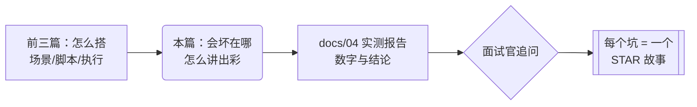

# 常见坑与面试（perf-test · 文档05）

> 一句话：把踩过的每个坑变成面试素材——坑的"现象→根因→证据→预防"四段式，比背八股有说服力得多。

## 1. 在整个工程中的位置

## 2. 涉及文件

| 坑 | 关联文件 |
|---|---|
| JMX 字段名错误（assertions / referenceNames） | `scenarios/*.jmx` |
| dev 端口耗尽事故 | `results/goods_dev_t*.jtl`、`docs/04` |
| waitress connection_limit 长尾 | `docs/04` 4.2 节 |
| order_no 碰撞 500 | `results/order_flow.jtl`、被测 `app/api/order_api.py` |
| 多实例共享 demo_mall.db | `README.md` 关键约定 |
| 库存耗尽式压测 | `scenarios/order_flow.jmx` 圈数设计 |

## 3. 坑清单（现象 → 根因 → 证据 → 预防）

### 坑 1：手写 JMX 两个"静默陷阱"——XStream 直接崩 vs 提取器空转
- **现象 A**：加载 jmx 报 `ConversionException ... path: .../ResultCollector/objProp/value/assertionResults`。
- **现象 B**：脚本跑完"正常"，但全链路 401，`${token}` 为空，jmeter.log 几乎无有效提示。
- **根因**：A——saveConfig 的字段名是 `assertions`，写成 `assertionResults` 未知字段反序列化失败；B——JMeter 5.x 的 JSON 提取器 XML 属性名是**复数**（`referenceNames`/`jsonPathExprs`），写单数时 JMeter 读到空值，提取器静默不设置任何变量。
- **证据**：A 对照 `bin/templates/mongodb.jmx` 的 saveConfig；B 反编译 `JSONPostProcessor.class` 得到常量名，且 GUI 生成一份标准 jmx 对照。
- **预防**：手写 JMX 一律以自带模板为底；提取器调试期先加"哨兵默认值 + 下游断言"，让静默失效变成显式 401（本工程就是这么兜底的）。

### 坑 2：dev 模式高并发"错误率 99.8%"——差点冤枉了被测系统
- **现象**：dev 模式 50 并发起错误率 64%→99.8%，第一直觉"Flask dev server 不行"。
- **根因**：错误码全是**客户端** `BindException: Address already in use`——Werkzeug 每响应 `Connection: close`（短连接），压测机每秒新建数百连接，Windows 临时端口仅 16384 个，被 TIME_WAIT 吃光后新连接无端口可用。
- **证据**：jtl 错误码分布（100% BindException/ConnectException，无任何 5xx）；`curl -I` 看到响应头 `Connection: close`；`netsh interface ipv4 show dynamicport tcp` 显示端口范围 49152-65535。
- **预防**：错误率异常先查错误码分布再下结论；压测机端口范围/句柄数列入压测前检查项；被测端支持 keep-alive 是压测吞吐的第一前提。
- **面试金句**："错误率 99.8% 的第一责任人不是被测系统，是我的压测机。归因链走完才发现，真正该改的是连接模式。"

### 坑 3：waitress connection_limit=100 的 20 秒长尾
- **现象**：prod 150 并发 0 错误，但 max 23546ms、52 笔请求超 1s。
- **根因**：waitress 默认 `connection_limit=100`，达到上限后**停止 accept**，新连接在内核 backlog 排队，等老连接释放。
- **证据**：被测日志 11 条 `WARNING:waitress:total open connections reached the connection limit`；jtl 中 52 笔 >1s 样本与告警时间吻合；P95 仅 142ms 说明不是服务端处理慢。
- **预防**：压测前查服务端并发连接上限类参数（waitress connection_limit、gunicorn worker/backlog、tomcat maxConnections）；结论里"0 错误"必须与长尾样本数一起说，否则掩盖了过载行为。

### 坑 4：order_no 秒级碰撞——压测测出了一个功能 bug
- **现象**：order_flow 默认参数两轮各 4 个错误：下单 500 ×2 + 支付 404 ×2。
- **根因**：`order_no = "ORD" + 秒级时间戳 + randint(100,999)`，同秒多单（10 并发时约 7~10 单/秒）碰撞概率约 C(n,2)/900，撞上即 `UNIQUE constraint failed` → 500 → 事务回滚 → 购物车残留 → 下轮加购翻倍，连锁放大库存消耗。
- **证据**：服务端 Traceback；错误模式"500 与 404 成对出现且时间相邻"；把思考时间调大到 800ms 后 310 请求 0 错误（同秒密度下降，碰撞概率约降一个量级）。
- **预防**：唯一单号生成用"毫秒时间戳 + 业务后缀 + 大随机空间"或 uuid；DB 唯一键冲突要捕获重试；压测报告里的"意外发现"单独成节，价值不低于性能数字。
- **面试金句**："性能压测最好的产出物之一是顺带抓到的并发功能 bug——这个缺陷在功能测试里几乎不可能复现，因为它需要同秒并发下单。"

### 坑 5：多实例共享 demo_mall.db——半路数据库"消失"
- **现象**：order_flow 一次运行中途，登录突然大面积 1001（用户不存在）→ 后续全 401；跑完一查，注册的 10 个压测账号只剩 0 个。
- **根因**：本机 5000/5001/5002 三个 mall 实例从**同一目录**启动，共享同一个 SQLite 文件；另一个会话调了 `/api/test/reset`，把所有实例的数据一起清了。我的注册发生在 reset 前，登录发生在 reset 后。
- **证据**：时间线对齐（登录失败起点 = 他人 reset 时刻）；reset 后 users 恰好只剩种子 2 人。
- **预防**：压测期间"数据库所有权"要唯一（协调其他任务、或为压测准备独立 DB 实例）；脚本遇到突发的 1001/401 先查数据是否被外部重置，再怀疑脚本。

### 坑 6：库存耗尽式压测——错误率全是 2002
- **现象**：按"固定时长 60s 无限循环"设计下单场景，压到后半段错误率飙升。
- **根因**：下单永久扣库存，种子库存 200 被打穿后全部返回 2002 库存不足——这是业务正确行为，不是性能问题。
- **证据**：jtl failureMessage 全是"库存不足"；压测前后 DB 库存对账。
- **预防**：**消耗不可再生资源的场景按圈数设计（圈数与库存匹配），可再生场景才按 duration**；压测前后做数据对账（订单数=圈数×线程数、库存差=总购买量）。

### 坑 7：杂项（一句话级）
- `-l` 指向已存在 jtl 会**追加**，新旧混合 TPS 翻倍——脚本先删。
- `-o` 报告目录非空直接报错——脚本先 `rm -rf`。
- jtl 的 `bytes` 列**含响应头**（67 字节 body 显示 193）。
- GUI 模式跑出来的数字不能当压测结果（Swing 与监听器抢资源）。
- JMeter 不设响应超时是**故意的**：设了超时，"慢"会伪装成"错"，丢掉长尾证据。

## 4. 为什么这样设计（把坑写成工程资产）

每个坑按"现象→根因→证据→预防"四段沉淀：现象让下一个人能对号入座，根因防止治标不治本，证据（错误码、日志行、反编译结果）示范"怎么证明"，预防变成 checklist。这套结构本身就可以直接搬进测试报告和复盘文档。

## 5. 怎么运行/验证

验证每个坑都真实存在（复现路径）：
- 坑 1A：把 jmx 里 `assertions` 改回 `assertionResults` → jmeter 加载报 ConversionException；
- 坑 1B：提取器属性改回单数 → 全链路 401；
- 坑 2：dev 模式跑 50 并发 30s → 错误率 60%+，错误码 BindException；
- 坑 3：prod 模式跑 150 并发 → waitress 日志告警 + jtl 52 笔 >1s；
- 坑 4：order_flow 默认档（loops=15）→ 大概率出现成对的 500/404；
- 坑 6：把 order_flow 改成 duration=60 无限循环 → 后段错误率全是 2002。

## 6. 常见坑（本篇即坑清单，此处列"最容易忘的三条"）

1. **先归因再下结论**：64% 错误率的结论是"压测机端口耗尽"而不是"服务端不行"。
2. **压测前检查环境假设**：端口范围、连接上限、数据库所有权、磁盘空间——四个假设任何一条崩了，数据全废。
3. **意外发现单独成节**：order_no 碰撞这类并发功能缺陷，是业务场景压测的独特价值，别埋在性能数字里。

## 7. 面试怎么讲

**30 秒版本**：
"这个压测工程我最想讲三个'差点翻车'的瞬间：一是 dev 模式错误率 99.8%，先查错误码才发现是压测机临时端口耗尽，根因是被测端每响应 Connection: close；二是 150 并发 0 错误但 max 23 秒，追到 waitress connection_limit=100 的背压告警；三是业务链路压测顺带抓到 order_no 秒级碰撞导致 UNIQUE 冲突 500 的真实并发缺陷。三个坑都走通了'现象→根因→证据→修复建议'的完整链路——这也是我认为测开和点点点的区别。"

**高频追问**：
1. *"这些坑怎么防止复发？"* —— 三层：压测前 checklist（端口范围/连接上限/DB 所有权/JMeter 版本属性名）；脚本层防御（哨兵默认值、数据对账、档间 reset）；报告层纪律（错误码分布必须出现、离群值必须给样本数、意外发现单独成节）。
2. *"哪个坑最能体现你的价值？"* —— order_no 碰撞：功能测试几乎不可能复现（需要同秒并发下单），是压测的业务断言层先发现 500+404 成对出现，再顺着服务端 Traceback 定位到单号生成算法。修复建议我给了三选一（毫秒戳+user_id / 更大随机空间 / 冲突重试）。
3. *"如果重来一次会怎么改？"* —— 两点：一是压测机与被测分离（双机或容器），绝对值更干净；二是提前加 Grafana 实时监控服务端 CPU/连接数，就不用事后从 jtl 反推排队行为了。

## 8. 复现任务清单

| # | 任务 | 验收标准 |
|---|---|---|
| 1 | 复现坑 1A：改坏 saveConfig 字段名 | 加载报 ConversionException |
| 2 | 复现坑 1B：提取器单数属性名 | 全链路 401、${token} 为空 |
| 3 | 复现坑 2：dev 三档 + 错误码分布统计 | BindException 占比 100%（T50/T100） |
| 4 | 复现坑 3：prod 150 并发 | waitress 日志告警 ≥1 条 |
| 5 | 复现坑 4：order_flow 默认档两轮 | 出现 500/404 成对错误（概率性） |
| 6 | 复现坑 6：下单场景改成 60s 无限循环 | 后段错误全是 2002 |
| 7 | 把六个坑整理成自己的复盘文档 | 每个坑四段齐全 |
